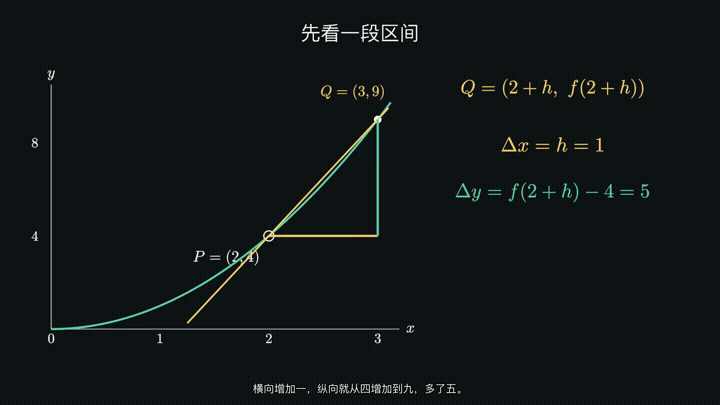

# ManiMind

ManiMind 是一个数学与物理知识动画项目。我们把课程问题、推理过程、图形和公式组织成可以观看、讨论和继续改进的一课，也维护制作动画所需的编排工具。

## 从哪里开始

- **看作品**：[已有成片](作品/成片/README.md)、[当前草稿](作品/草稿/README.md)、[历史版本](作品/历史版本/README.md)
- **找课程**：[高中数学与物理目录](docs/curricula/README.md)，按先修关系、理解目标和课题安排制作
- **做一课**：[制作流程](docs/开始制作.md)，从备课到动画、讲稿、配音和字幕
- **参与项目**：[协作方式](docs/参与贡献.md)、[运行与开发](docs/运行与开发.md)

## 作品与当前进展

已有播放包包括导数及其应用八课、机械波小单元、平抛运动和三题知识动画。完整文件保存在本机 `~/Desktop/01-知识动画/`，版本、文件名和获取位置集中登记在[作品目录](作品/README.md)；组员可向维护者取得对应播放包。

导数八课当前围绕公式连续性返修。01、07 的配音字幕修订预览已交付，其余课逐课制作和审核。人工听审与学生试用待安排。已有 2026-11-03 原配音字幕整章版保持原样，整章新版随逐课交付汇总。

下面展示新 01 修订预览的公式构建片段，完整视频及来源见[作品目录](作品/README.md)。



## 如何做一课

1. 从课程目录确定本课位置，明确学生已有基础和这次要理解的问题。
2. 用实际对象、图形和公式展开推理，完成动画并实看整段过程。
3. 由独立审核者看当前画面；返修已有作品时，同时比较有效内容的保留。
4. 按画面写自然口语讲稿，生成完整意群配音，核对原声、动画与单套字幕。
5. 将通过审核的版本整理成命名清楚的播放包，记录来源并更新作品索引。

详细步骤见[做好一课](docs/开始制作.md)，文件名称与交付方式见[命名与交付](docs/命名与交付.md)。

## 如何运行

Python 3.11 及以上可以先运行编排内核与纯数据测试：

```bash
python3 -m venv .venv
source .venv/bin/activate
python -m pip install -e ".[dev]"
MANIMIND_DISABLE_DOTENV=1 python -m pytest -q tests/test_workflow.py tests/test_task_board.py
```

macOS 动画环境使用 `bash scripts/setup-manimgl.sh` 准备，随后激活 `manimgl_env` 并运行 `python -m manimind.main doctor`。Windows 步骤及分层测试见[运行与开发](docs/运行与开发.md)。

## 目录

| 位置 | 内容 |
| --- | --- |
| [作品/](作品/README.md) | 成片、草稿和历史版本的观看索引 |
| [docs/](docs/README.md) | 给组员的制作、开发与课程资料 |
| [ai/](ai/README.md) | Agent 规则、执行契约、审核细节与技术参考 |
| [archive/](archive/README.md) | 历史说明、旧实验记录与迁移清单 |
| `src/manimind/` | 编排、课程、渲染、审核和后处理代码 |
| `examples/`、`configs/`、`tests/` | 场景源码、配置和测试 |
| `runtime/`、`outputs/` | 本机制作计划、协作证据与版本媒体 |
| `resources/` | 第三方精选资产及其来源、许可证 |

## 一起参与

协作仓库：[gduf-community/ManiMind](https://github.com/gduf-community/ManiMind)。可以从补一份教案、指出一个具体画面问题、改善一段动画或补一个测试开始。先与负责人确认课次和文件范围，再提交修改与验证结果。

工程细节从 [AI 与开发工具导航](ai/README.md)查阅；早期设计和实验资料保存在[历史归档](archive/README.md)。
