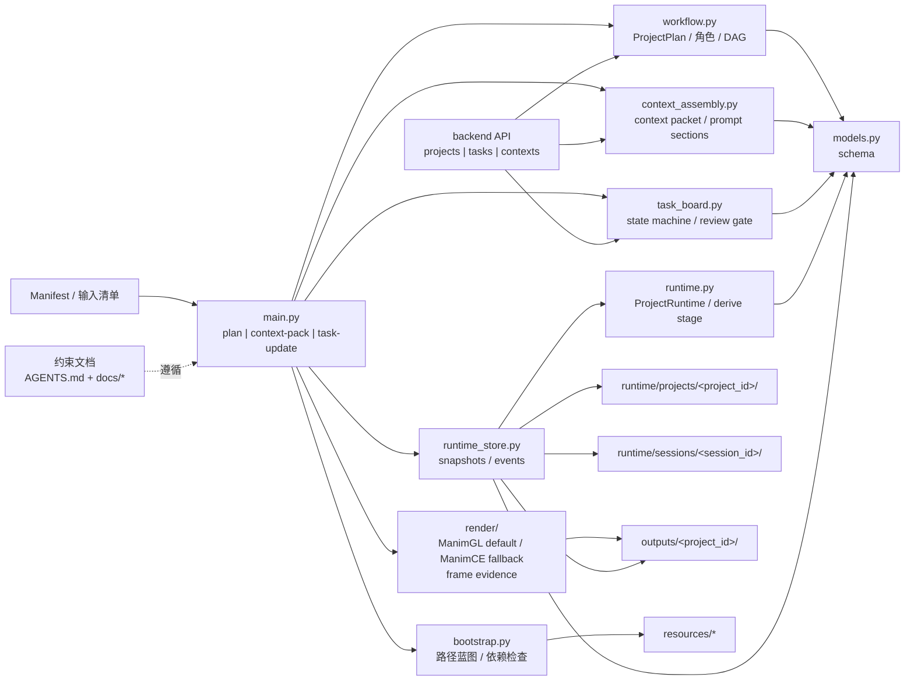

# ManiMind 项目架构设计

当前阅读入口已按人类文档、AI 执行资料、历史归档分区；见 `README.md`、`ai/README.md` 与 `archive/migrations/20261103/manifest.json`。下文保留各代实现的技术描述。课程入口优先采用当前 v3 监督链；基础历史 `pipeline-run/assemble-video` 已在 CLI 边界默认隔离，精确范围见 [历史 CLI](../legacy-cli.md)。

本文件描述当前仓库已落地的编排架构，不再只是规划草图。

## 零、官方架构图工件

- `docs/architecture.canvas` 是当前仓库的正式架构白板。
- `src/manimind/` 模块边界、角色分布、状态落盘路径、上下文装配链路、第三方能力接入方式发生变化时，必须在同一次修改中同步更新：
  - `docs/architecture.canvas`
  - `docs/通用项目架构模板.md`
- 当前白板粒度固定为“模块/子系统级”，用于表达编排关系、状态流向与外部能力边界，不追求把每个测试文件都画进去。

## 一、当前架构图

当前公式返修以 `traceable_film_v3.py` 监督冻结v2：create-only准备先拒绝既存链接，全部声明帧/联系表、原生索引及监督器源码SHA一起绑定派生的 `supervised-evidence.json`。纯审核监督器不改变几何或时钟，其升级使本轮取证/审核失效而不要求重绘完全相同画面。v4.3.1仍是动画输入；正式稿安装与静音交付必须走v3，而非未加保护的旧CLI。详见[当前监督入口](../../docs/formula-continuity-v3.md)。

`postproduce/traceable_film_v2.py` 是v4.3.1明确选择的公式连续性监督适配器，保留v1诊断实现。作者在渲染plan列出推理承重动作，独立首看在当前报告中逐项举证身份、运算及源/过程/目标真实帧；适配器核对当前媒体帧索引、哈希、实际解码像素、原生bindings及首看/回归Agent与context的双重隔离，再复用冻结`unit_film`的正式稿安装/静音发布。后续原音与字幕仍绑定不可变已审静音来源，不改旧执行器或旧片批准。`components/formula_transfer.py`仅复用原生语义动画，从实际源位置复制，保留可读历史，不推断代数或担保路径无碰撞。长期动作选择、短期独立观察与版本媒体分离，生命周期见[公式连续性](../../docs/formula-continuity-v2.md)。

`experiments/chapter_workflow.py`为整章监督制作复用既有`curriculum/understanding_render/unit_film`门禁：版本化章目录仍在长期projects，各课执行锁、阶段包和独立评语在sessions，实际媒体在各课outputs。它不调用LLM或TTS、不代写批准，不把单课完成等同整章完成；执行中与未决进程通过排他锁拒绝重复，失败版本保留。八课导数案例保留已发布首课的原来源，新增课消费新的整章unit；完整章节还须覆盖清单、逐课发布及章节组装审核，库存完整性本身不等于媒体或学生理解通过。

课程单元新增`curriculum.py`与`unit_film.py`：前者从长期unit和CSV提取本课出口及前后课意图，后者复用真实渲染、独立质量审核及V01 worker，支持schema3连续意群对多个focus。`phrase_alignment.py`在独立环境估计原音子句时刻，`meaning_units.py`求段内各指称的可行排程；完整原音与单套字幕经独立审核后交付，不把模型时间戳当听审。生命周期、同文声音复用与未自动接入旧模型执行器的范围见[课程单元工作流](../../docs/course-unit-workflow.md)。

课程案例按实际依赖隔离失效范围：每课scene独立消费共享表现辅助与科学模型，单课配音节奏返工不让无关课自动失效，共享模型改变则重审所有消费者。机械波示例对应`wave_unit_shared.py`、`wave_unit_model.py`及三课独立scene，历史聚合源不再作为新生产依赖。

字幕后处理`focus_captions`在既有视觉/讲稿/真实声音时序批准之后接入：保留来源与原音，先制作不缩放原画的单套字幕候选，再经独立像素审核才复制交付。候选及样式/ASS/字幕清单位于outputs，独立审片和帧在runtime/sessions，不把候选或字数比例拆分计时当成发布或词级听审；详见[字幕模块](../reference/focus-captions.md)。

已发布正文可由`postproduce/lesson_opening.py`窄范围扩展片头：原`unit_film.release_captioned`来源和全部门禁重新验证，片头计划/制作收据/源码/MP4/WAV哈希及独立像素、文稿、时序批准先于合片。正文视频只复制码流，全量解码帧及PTS后缀严格相等；完整原音PCM不裁切、不变速、不增益，片头仅允许尾部补零，拼接后一次AAC编码。候选再经现有`content_regression.contract_bindings/validate_comparison`真实门禁与不同比较上下文的最终seam/caption像素审核，才复制发布。长期计划/合同、短期真实审核/帧、create-only候选PCM/交付分目录，任一绑定变化失效；无听审明确`not_performed`，只交完整预览，不改旧发布器、不调用TTS/GPU。详见[片头扩展](../reference/lesson-opening.md)。

可变句数声音旁路新增独立维护封装`run-windows-flexible-voxcpm.ps1`：操作者先暂停空闲客户端和Qwen，生成时只有worker取得共享互斥量；子进程退出后封装器重新持锁验证原服务恢复，禁用任务或其他持锁者不自动启用/抢占。Windows桌面GPU快照是短期操作员批准，固定设备/驱动/进程并拒绝未知变化，不是长期模型上下文、整卡独占证明或自动调度器；详见[配音维护核验](../../docs/remote-speech.md#windows-桌面维护核验)。



## 二、输入与输出

输入：

- 论文 PDF
- 用户笔记
- 目标受众与风格要求
- 镜头清单 manifest（JSON）

输出：

- 结构化项目计划（含角色、上下文、任务图）
- 角色上下文包与提示词分段
- 任务状态推进记录
- 审核报告与输出资产清单

## 三、架构分层

```text
预启动层
  ├─ 文档与配置加载
  ├─ 运行时依赖检测（resources + tools）
  └─ 路径蓝图生成（runtime/projects, runtime/sessions, outputs）

编排核心层（src/manimind/）
  ├─ models.py            数据模型：角色、上下文、任务、状态
  ├─ workflow.py          角色编排、上下文蓝图、任务依赖图、审核关卡
  ├─ context_assembly.py  上下文包与提示词分段装配（含缓存）
  ├─ task_board.py        任务状态机（owner/blocker/verification nudge）
  ├─ runtime.py           ProjectRuntime 加载、状态回填与阶段派生
  ├─ runtime_store.py     项目状态、上下文包、任务更新的落盘与日志
  ├─ render/              ManimGL 默认后端（manimgl.yml）、ManimCE 兼容后端与关键帧证据
  ├─ review/              渲染证据、帧质量、跨帧运动、动态 Tex 成本、公式-图形绑定与语义颜色一致性预检
  ├─ postproduce/         基于审核证据拼接分段视频，生成预览成片
  ├─ bootstrap.py         初始化、外部路径检查、参考归档检查
  └─ main.py              CLI 入口（plan/context-pack/task-update）

历史 API 原型（archive/legacy/backend/）
  ├─ main.py              FastAPI 入口
  └─ api/*                projects/tasks/contexts 路由

执行能力层（第三方）
  ├─ resources/skills/html-animation/
  ├─ resources/references/hyperframes/
  └─ resources/skills/manim/SKILL.md（ManimCE 参考，不是默认 API 契约）
```

## 四、角色架构（已实现）

角色通过 `AgentMode` 三态约束行为：

- `read_only`：只读探索或规划，不允许产物写入
- `structured_write`：允许写入结构化产物，必须遵循归属
- `verify_only`：只输出审核结论，不参与内容生产

默认角色集：

- `lead`
- `explorer`
- `planner`
- `coordinator`
- `html_worker`
- `manim_worker`
- `svg_worker`
- `reviewer`

每个角色都有：

- `allowed_stages`
- `required_inputs`
- `owned_outputs`
- `output_contract`

实现位置：`workflow.build_agent_profiles(...)`。

## 五、状态机与任务图（已实现）

阶段状态机：

```text
PRESTART -> INGEST -> SUMMARIZE -> PLAN -> DISPATCH -> REVIEW -> POST_PRODUCE -> PACKAGE -> DONE
                                                \-> BLOCKED
```

任务级状态机（`ExecutionTask`）：

- 状态：`pending` / `in_progress` / `completed`
- 约束：`blocked_by` 必须全部完成后，任务才可推进
- 所有权：只有 `owner_role` 或 `lead` 可推进任务
- 强制审核：`review.outputs` 为验证关卡，未完成不得进入后处理

实现位置：`task_board.list_available_tasks(...)` 与 `task_board.update_execution_task_status(...)`。

## 六、上下文装配（已实现）

上下文记录由 `ContextRecord` 建模，字段包括：

- `scope`（长期/短期）
- `writer_role`
- `consumer_roles`
- `lifecycle`
- `invalidation_rule`
- `sticky`

上下文注入由 `build_context_packet(plan, role_id, stage)` 实现：

- 按角色模式 + 角色必需输入选择上下文
- 返回统一 `constraints` 与 `write_targets`
- 可选渲染提示词分段（`PromptSectionCache`）

## 七、CLI 接口（已实现）

- `plan <manifest>`：构建完整项目计划
- `context-pack <manifest> <role_id> <stage>`：输出角色上下文包
- `context-pack ... --render-prompt-sections`：输出提示词分段
- `task-update <manifest> <task_id> <status> <actor_role>`：按状态机推进任务
- 三个命令均支持 `--session-id`，并会把结果落盘到 `runtime/projects/...` 与 `runtime/sessions/...`
- `pipeline-run ... --render-manim`：Manim Worker 生成代码后调用 ManimGL 渲染，并抽取关键帧作为审核证据；Reviewer 会对视频路径、抽帧路径、帧尺寸、亮度、对比度、视觉细节、跨帧运动、Manim 代码解释性信号、公式-图形绑定和跨镜头语义颜色一致性做确定性预检，失败时强制阻塞
- `pipeline-run ... --manim-backend manimgl|manimce`：选择本轮代码生成与渲染后端，默认 `manimgl`；选择值由 CLI 写入 Worker 输入，Worker 写入每段长期上下文，渲染器和 Reviewer 消费，新的同段 approved/evidence 记录会使旧选择失效
- `quality-audit <manifest>`：读取长期上下文中的 Manim 代码与渲染证据，不调用 LLM，生成机器可读的 `outputs/<project_id>/quality-audit.json` 与人工审片用的 `outputs/<project_id>/quality-summary.md`
- `assemble-video <manifest>`：读取长期上下文中的 Manim 渲染证据，按 manifest 镜头顺序用 ffmpeg concat 拼接分段视频，生成 `outputs/<project_id>/<project_id>-final.mp4`
- `build-subtitles <manifest>`：读取旁白脚本和分段视频真实时长，生成 `outputs/<project_id>/<project_id>.srt`
- `mux-subtitles <manifest>`：把 SRT 作为软字幕轨封装进成片，生成 `outputs/<project_id>/<project_id>-final-subtitled.mp4`
- `burn-subtitles <manifest>`：把 SRT 字幕烧录进画面，生成平台通用审看片 `outputs/<project_id>/<project_id>-final-burned.mp4`
- `build-voiceover <manifest>`：使用 Windows SAPI 从旁白脚本生成离线 WAV 旁白
- `mux-voiceover <manifest>`：把旁白合成进烧录字幕版视频，并在时长不一致时按旁白长度缩放视频节奏

## 八、精修试片入口

`src/manimind/postproduce/pilot.py` 是独立于 `pipeline-run` 的有界实验入口，服务于 `configs/velocity-pilot.json` 与 `examples/instantaneous_velocity.py`。它复用 `render/` 的 ManimGL 调用和抽帧，不重写渲染引擎。场景针对本机中文字形缺损使用 Pillow/FreeType 生成透明文字贴图，交由原生 ImageMobject 显示；可重建贴图属于输出媒体，不属于长期事实或短期协作状态。

`prepare` 在制作前实测逐句配音并生成时间轴；`render` 生成无配音的场景；`inspect` 生成实际画面及哈希；独立 Reviewer 审核通过后，`assemble` 才允许生成带声音的成片。源码、配置、时间轴、音频或视频发生变化，旧审核立即失效。

长期事实和审核仍保存在 `runtime/projects/velocity-pilot/`，本轮临时日志在 `runtime/sessions/velocity-pilot-20261014/`，媒体及证据在 `outputs/velocity-pilot/`。外部可选配音服务为 `edge-tts`，离线回退必须显式指定。详细状态写入者、消费者、生命周期、失效规则见 [试片说明](../../archive/legacy/docs/velocity-pilot.md)。此入口不是无人干预的通用生成能力。

### 完整讲解片

`postproduce/full_lesson.py` 复用试片的数学视觉组件与底层渲染/审核工具，把候选模型的12段讲稿数据转为完整连续讲解。初始化冻结原稿和工程组件源码快照；实际TTS驱动时间轴，渲染版本保留，独立Reviewer必须覆盖每段实际像素。合成同时验证源码、事实、模型稿、时间轴、音轨、配置、编排及视频哈希，不以候选模型自检放行。新项目长期上下文、短期制作日志与派生媒体仍分目录，详细写入者、消费者、生命周期及失效规则见 [完整讲解片](../../archive/legacy/docs/full-lesson.md)。这是固定选题、工程组件支撑的制作入口，不是模型独立生成任意视频。

### 自由场景试片

`postproduce/freeform_pilot.py` 是新增的人工监督入口，不改变上述历史实验。它保留 `prepare → render → inspect → 独立审核 → assemble`，但不固定镜头数、构图、动画数量或可选教学组件。旁白 cue 只提供实测音频时间边界；Manim Worker 可创作连续世界。主 Agent 编排，独立 Reviewer 逐 cue 审阅实际像素和事实，哈希绑定实现、字体、时间轴及媒体后才能合成。此路径执行明确检查过的本地代码，尚无安全沙箱或审核身份认证；不是无人值守量产系统。

首个项目为 `projectile-story-20261020`。长期事实与审核、短期制作事件、派生音视频分别进入标准的 projects、sessions、outputs 目录，写入者、消费者及失效规则见 [自由叙事试片](../../archive/legacy/docs/projectile-story.md)。原理验证与学生理解测试不能互相替代。

`postproduce/playback_package.py` 位于既有审核与合成之后，只复制交付清单哈希绑定的 MP4；检查原审核批准和音视频流，不重渲染、不生成新批准，不修改冻结实验。已烧录字幕的播放目录不放外挂字幕，原始字幕留在原实验目录。`outputs/<export-id>/manifest.json` 由打包器写、观众/审计者消费，生命周期为不可覆盖的单次交付，媒体或来源证据哈希变化即失效；不新增长期事实或短期创作上下文。见 [播放交付](../reference/playback-package.md)。

`experiments/freeform_isolated.py` 在此媒体入口上增加独立 API 作者：只输入公共任务/事实/通用工具，不输入参考片或主对话。作者自行生成讲稿与场景，固定次数自修复，保留全部原答与成本；`freeform_support.py` 无教学场景，仅负责字体、时间与字幕。渲染先检查代码并限制网络/其他项目读取；仍不构成对抗性安全证明。作者自检与独立审批分离，不修改历史试验。长期协议、短期请求、媒体及失效规则见 [DeepSeek 自由创作试验](../../archive/legacy/docs/deepseek-freeform.md)。

`experiments/freeform_agent.py` 继承其媒体和来源链，新增有界自主动作解释器。作者自行调用本地API查询、渲染、分段原帧检查及逐字改码；模型笔记、工具结果与进度只放短期会话，长期冻结协议不混入临时尝试。新稿/新渲染清空自检覆盖，全段覆盖也不代表独立放行。模型无任意文件、shell或网络工具；场景受读写/网络沙箱与静态能力筛选约束。旧实验不迁移，详细状态与限制见 [自主制作实验](../../archive/legacy/docs/deepseek-autonomous.md)。

`experiments/freeform_review_cycle.py` 新增独立同模型审片者，只消费公共任务、当前内容、实测时钟与真实抽帧，不读作者推理或历史外部评语。其原始分段/全片审核交回自主作者进行最多两次返工，角色请求分账、统一费用上限。沿用的同作者种子有来源绑定；旧实验不修改。长期冻结协议、短期角色请求/反馈、派生媒体三者分离，API 审片与最终发布验收仍为不同关卡，见 [独立审片返工](../../archive/legacy/docs/deepseek-review-cycle.md)。

审核结构失败时，新实验可通过 `freeform_review_retry.py` 在相同输入及原始错误下让 reviewer 自行修复一次JSON；不添加内容建议，不改旧冻结工具，历史失败费计入总预算。新协议长期冻结，错误/原答仍只在短期会话，API审片仍无发布权。

`experiments/freeform_max_effort.py` 是不采用旧种子的全新上下文入口：作者与审片者均启用 `thinking=enabled` 和 `reasoning_effort=max`，流式记录响应与实际用量，不设金额、调用、渲染或审核循环上限。复用现有沙箱和发布门禁，不改变历史候选；长期冻结协议、短期角色请求/全量动作历史、输出媒体三者分离。网络与渲染超时、无变化的重复失败仅作故障保护，不冒充花费上限。详见 [全推理隔离制作](../../archive/legacy/docs/deepseek-max-effort.md)。

`experiments/freeform_team.py` 新增空白上下文三角色协作入口：DeepSeek 主控自主规划、委托和看图，DeepSeek 创作者自主实现，异上下文 DeepSeek 审片者审核原始分辨率抽帧。原始委托与评语不经 GPT 修改；主控无源码写权限，创作者无发布权限。长期冻结协议、短期角色独立历史与共享检查点、输出媒体/计时/费用分离。变更内容清空双方检查覆盖；仅真实独立审片全部通过，机械适配后才进入已有发布门禁。冻结历史执行器不改。完整生命周期、故障恢复和比较限制见 [三角色协作实验](../../archive/legacy/docs/deepseek-team.md)。

`experiments/codex_cli_team.py` 为同一三角色媒体流程增加 GPT-6.1 Sol 订阅入口。每次推理开启独立临时 CLI 会话，禁用主对话继承、项目文档注入、记忆和原生 shell/联网/插件工具，只处理相同 JSON 动作与当前实验图片；公共任务与 DeepSeek 协作版逐字段相同。复用媒体来源、返工和审核门禁，角色 token/缓存分别记账，账户额度快照与 token 等价额度区分，原生 Codex 包装的差异明确保留。状态沿用三角色目录，新增 CLI 原始事件与调用证据，不改旧冻结实现。见 [Sol 订阅协作实验](../../archive/legacy/docs/sol61-team.md)。

`experiments/subscription_quota.py` 为订阅实验独立记录账户额度快照，调用只读账户接口并在团队结束时退出，不进入角色上下文；短期原始读数和输出派生报告分离，不改变冻结制作执行器。额度重置使简单起终差值失效。

`experiments/learning_workflow.py` 复用三角色原答/权限/渲染/发布链，冻结通用profile与量表，先不提供作者源码/讲稿做像素首看，再以新请求复核源码、旁白与时钟，两者均须通过。`review/learning_quality.py` 负责字幕机械预检与评分证据/关键维度校验，不创作教学模板。每0.5秒取证补充原分辨率帧，版本变化使旧覆盖与批准失效。study、配置及外部评估在长期目录，角色请求仍在短期目录，版本原帧、诊断和播放包在输出目录。两道开发题以最终profile通过外部评估并冻结后才开放留出题，留出用于调参须新建study。生命周期、运行与限制见 [教学工作流迭代](../../archive/legacy/docs/learning-workflow.md)。

当前优化采用 `experiments/sol_learning_workflow.py`：组合通用教学工作流与 `CodexTeamExperiment`，使用新 study 和全新角色上下文，所有制作角色均选 GPT-6.1 Sol max。不继承 DeepSeek 中止尝试；原实现与费用记录保持冻结。运行适配器、Sol 入口及额度观察器在调用前哈希绑定。长期账户基线、短期只读采样及输出额度报告分别存储；每角色原始 token 可归属于本片，账户变化不可排除其他聊天。独立审核、字幕与时序证据门禁继续生效。

v1真实审核输入中的字幕诊断`rows`间接提供了字幕全文，不能宣称完全无讲稿首看。新增`archive/legacy/src/manimind/experiments/sol_learning_v2.py`在最终装配边界仅透传当前分组机械诊断的白名单字段，不传字幕正文、完整span或未来分组发现。独立源码/讲稿复核保留，原审核校验和发布门禁不被绕过。v2模块与profile在新调用前冻结，v1原样保留；长期偏差记录由协调者写、审计者消费，绑定输入和原答哈希，输入变化即失效，不能抹去失败或费用。

`archive/legacy/src/manimind/experiments/learning_background.py`为Sol v2增加单独的OS启动适配器，不改变冻结的制作实现。只在study/profile有效、无活跃runner、无团队锁和未决请求时启动，写短期启动收据及源码/配置哈希，随后由原团队锁与检查点管理。启动收据不成为创作上下文，不允许借后台运行重发未知收费请求。

`archive/legacy/src/manimind/experiments/sol_learning_v3.py`增加批量取证：接口查询在本机分组，多个当前cue的联系表一次返回，成功渲染自动提供实际图片而不伪造模型观察。独立审核为两个新上下文的逐cue全片审核，分别无稿首看和源码/时序审计，均保留原分辨率与0.5秒证据、补帧、结构验证和发布门禁；量表不变、任一未过不发布。减少分组判断的质量风险需用实际回归评估。后台启动器显式区分sol-v2/sol-v3并验证profile，冻结历史实现不变；长期协议、短期原答/观察和输出证据的生命周期沿用原模型。

`experiments/learning_runtime.py` 作为该入口的宿主运行适配器，在导入本地ManimGL API前隔离CLI参数；适配器绑定写入长期 `runtime-adapter.json`，已完成调用数明确保留。只读动作恢复收据写入原短期step目录，绑定原请求和未变的候选哈希，不授予未知副作用动作重放权限，不再次收费请求。

`archive/legacy/src/manimind/experiments/deepseek_learning_v3.py`增加官方DeepSeek high适配，直接继承 `LearningWorkflow`，不继承或调用Sol订阅传输。新study采用同一v3 profile及逐字段相同的平抛公共任务；两种独立审核直接复用冻结方法，批量接口/图片行为一致，主控、创作、审片及结构修复均为high。长期协议/适配器绑定、短期分角色原答/启动收据、输出媒体/费用仍分离；源码和profile漂移使批准失效，未决请求阻止重发。旧冻结实现不变。模型与推理等级不同的单片比较不视为只改变模型的因果实验，未听审及未做学生理解测试的限制保留。详见 [教学工作流迭代](../../archive/legacy/docs/learning-workflow.md#deepseek-high-同工作流实验)。

## 视觉优先制作

监督改片新增v3内容回归：`configs/visual-first-workflow-v3.json`给创作保留功能的引导；`review/content_regression.py`消费长期任务基线合同和短期独立比较，验证实际媒体/清单及各项前中后证据。`understanding_render`归档合同和实现，`understanding_film`在正式稿及发布前执行第二道门，并将比较原答哈希保留到交付与后配音来源链。主控选基线、作者自由改表现、不同上下文分别做新版首看和新旧比较。有效内容损失不能靠总分抵消；具体保留项按任务而非通用模板决定。现有自主模型协议仍不支持基线比较动作，不据此声称已无人值守量产。完整状态生命周期见[内容回归](../../docs/content-regression.md)。

新增项目的理解优先v2将创作引导与审核标准分离：`sol_understanding_first.py`保留原自由创作工具，实际注入和再次校验`understanding_quality`的可见推理、注意力、节奏、语义对应及迁移证据。`understanding_support`记录实际可读区间，`semantic_focus`以完整真实WAV检查区间覆盖，不仅验证起点晚于事件。`understanding_render`归档来源和新像素，`understanding_film`执行视觉首看、后写稿审核、声音、全句时序及封装的分阶段批准；`flexible_voxcpm`移除当前选声worker固定17句的局限，仍保留原音/首条/互斥及失败证据。长计划、短审核、分版本媒体不混写；视觉变化重渲染，文本或发布标准变化重新审核相应阶段。没有固定题目、章数或统一秒数，没有真实声音时只交静音与可续任务。详见[理解优先工作流](../../docs/understanding-workflow.md)。

公式精修另由`components/formula_motion.py`提供原生Tex的语义身份与显式配对，不自动推断代数或重写LaTeX引擎。`postproduce/formula_refinement.py`在新版本输出中只替换已声明的视觉区间，复用原AAC；计划、实际事件/轨迹/像素和独立六哈希审核分离，变更即撤销批准，不将旧静音审核沿用为新画面批准。内部无损master校验其余帧，另出兼容High播放版；不覆写旧实验、原视频或TTS。示例是监督精修，不计为隔离模型原始成绩。详见[公式动效](../../docs/formula-motion.md)。

全片精修由`postproduce/formula_film.py`接入相同边界：保留六章114秒时钟，逐句验证既有旁白相对真实事件的先后关系；分离创作与最终审核角色，绑定全片/计划/源码/轨迹/像素后才复制原AAC和新视觉码流。新尝试保留完整证据，不覆盖局部精修或冻结原稿；媒体、时间、源码变化即使审核失效。

用户选定音色后，`postproduce/voxcpm_narration.py`通过官方本地参考音色接口逐段合成，复用冻结试听helper；`visual_narration.py`以原SolVisualFirst的真实独立批准为前置，机械保持17条讲稿及视觉时钟。长计划独立保存于新配音项目，短期维护/异常/独立时序审核单列；每段原音/收据及新时序表按源码、模型、参考、讲稿和媒体哈希失效。完整原句在事件关系和镜头真实边界内排程，不变速、不自动修文案或运动。审核通过后才混音并stream-copy原视频；主片仅视频/音频两轨、无内嵌/烧录/同名外挂字幕，可选SRT放support，仍明确未听审/未学生测试。详见[配音阶段](../../docs/remote-speech.md#选定-v01-后的完整配音)。

VoxCPM2补测通过`postproduce/voxcpm_audition.py`单文件旁路调用官方API，在Windows独立环境运行，不继承Qwen声线或参考音频。固定模型revision、同文三种子、禁隐藏重试和自动编译；原生48kHz原音与固定增益副本分别保存。安装清单、短期维护日志/单次进程state、候选收据与长期选声偏好各有归属，模型/依赖/代码/媒体变化使相应绑定失效。GPU维护与VoiceDesign共享互斥量，先协调唯一已知客户端维护窗口、再由操作者暂停Qwen，运行器拒绝自行停在线服务，finally恢复原服务；这不是多用户原子排空调度器。离线页只追加试听、不自动发布，详见[配音服务](../../docs/remote-speech.md#voxcpm2-无参考补测)。

新增独立后配音能力：`postproduce/qwen_service.py`复用FastAPI和官方Qwen公共API作为Windows回环GPU服务，`postproduce/remote_speech.py`在Mac通过SSH转发接收并校验音频，拒绝重定向及隐式代理。两端Tailscale只承载私网连接，不接管DNS、子网路由或出口；Windows原生OpenSSH按地址/公钥来源限制Mac，Mac由launchd恢复专用隧道。安装器仅创建专用模型环境，配音任务以S4U/Limited运行；受SYSTEM/Administrators保护的独立开机检查只处理私网地址就绪后的SSH监听，不是声音生成角色。长期主机/部署信息、短期连通性检查与输出声音收据分离；缓存以模型/代码/请求指纹失效，密钥仅驻留两端私有配置，开机检查日志仅供当次运维诊断。该层只生成声音，不改变冻结视觉时钟、不自动合成或越过审核；声音和真实音画同步需独立验收，样音/连通证明不代替整机重启及听审。详见[独立GPU配音服务](../../docs/remote-speech.md)和[连接说明](../local-services.md)。

`postproduce/cosyvoice_audition.py`作为旁路的一次性自然度试听适配器，只调用已装CosyVoice3公共引擎，不改常驻Qwen或冻结制作器。准备器只使用官方固定revision模型及公开演示参考，排除私人speaker库；运行器在Qwen空闲时临停/归还本次任务，单次目录排他防重。单次进程状态/日志、绑定输入和软件哈希的候选/收据、长期用户风格/音色反馈分别管理；失败和听感未通过不成为发布批准。固定A的表达指导不保证跨模型韵律相同，官方演示参考也不授予商业声音许可，完整音画仍走独立审核。详见配音服务中的合成感对照入口。

`postproduce/preset_audition.py`增加无参考声的本地预设试听旁路：Qwen复用原服务，Kokoro在专用环境通过官方KModel/KPipeline运行；只写新候选与来源收据。部署清单、单次进程state、候选manifest及长期用户偏好分别管理，输入/权重/依赖/媒体变化使绑定失效，未听审不批准成片。原音和固定增益试听副本分开，离线HTML只读取当前manifest与本地媒体，不扩大网络暴露或改变冻结视频。详见配音服务中的本地中文预设同文试听。

`postproduce/voicedesign_audition.py`扩展为独立原创声线选角：只调用官方VoiceDesign公共API，固定模型文件、长期设计计划、单次进程状态、归档源码及候选收据分别建模。运行器用互斥量/排他目录避免重复；后续必须使用协调后的独占维护窗口，检测在线Qwen即拒绝，不自动中断请求，finally限时验证原服务恢复，不触碰外部广告素材。新旧组合只生成试听包，旧13条字节不变；manifest分组区分设计目标与固定speaker，音量副本保持透明，任何输入/模型/源码/媒体变化使绑定失效。没有听审或完整音画批准，不通往视频发布。

该选声旁路另识别独立`minimal-female`计划，不修改原10条设计计划；三条短描述的实际instructions不再附加原风格文本。`append-minimal`重新核对原23条和新3条、绑定旧manifest SHA并在新目录追加，保留旧页面与所有原音/音量副本。UI的priority、group与kind只管理本组呈现/筛选，生命周期随manifest，不能承载过程审批或替代听审；维护操作、短期日志、长期偏好继续分离。

审片的明确capacity故障通过独立`archive/legacy/src/manimind/experiments/sol_visual_recovery.py`原样恢复补帧详情请求；它不是新创作路线，不修改冻结实现或内容。恢复收据/原状态快照属短期会话，分段耗时和额度报告属输出，恢复器指纹与请求/媒体哈希绑定，退出或哈希变化失效；未知请求不重发、真实审核仍强制。细则见视觉优先文档。

新增视觉优先路线 `experiments/sol_visual_first.py`：仍由三角色自主协作，但初始规划只产生视觉时钟，不调用TTS；创作者以 `visual_first_support.py` 的通用字形/时钟和实测事件实现动画。无稿静音像素审核通过后，主控才可依据真实事件写后配音文本；另开上下文审核源码、科学条件、事件和讲稿，两审及原答/媒体哈希全部匹配才能导出静音主片。`visual_first_data.py`负责可验证纯数据契约，不创建教学模板。长期协议/来源、短期角色与阶段状态、输出媒体/费用继续分离；视觉变化撤销两审和讲稿，文本变化只撤销后配音稿审核。最终开源语音、真实音画同步和听审尚未接入，不把当前静音主片当有声交付。旧配音先行实现不改，状态生命周期见 [视觉优先工作流](../reference/visual-first-workflow.md)。

## 九、国内模型与校内部署实验

`experiments/model_benchmark.py` 是独立的有界对照入口，不改变主工作流。输入固定教案/配音/时间轴和 `configs/model-benchmark.json`；通过 `llm/client.py` 调用指定国内 API 或学校兼容接口，输出原始场景代码。客户端记录逐请求 usage、实际模型和延迟，禁用 SDK 隐式重试；实验最多两次生成，不人工改写模型场景。

`scene_support.py` 只负责中文贴图和时间轴，不提供教学视觉答案。渲染前必须明确执行已检查源码，渲染后将抽帧和哈希交给独立 Reviewer，仍通过既有 `pilot.validate_review` 后才合成。`runtime/projects/<run-id>/` 保存教案快照和审核，`runtime/sessions/<run-id>-generation/` 保存临时提示/回答/失败，`outputs/<run-id>/` 保存逐次源码、视频、用量报告和合格成片。CLI 在短期会话中排他创建 `command.lock`，命令结束释放，异常残留需人工确认原进程后处理；直接内部函数调用不提供互斥。当前为人工监督实验，不具备渲染沙箱或认证审核服务，不能直接无人值守量产。状态生命周期、实测失败与限制见 [model-benchmark.md](../../archive/legacy/docs/model-benchmark.md)。

短镜头实验沿用上述模块与路径：`--cues` 将连续的原始教案、时间轴与 PCM 音轨裁成同一个片段，并在长期 `experiment.json.excerpt` 冻结来源哈希和帧范围。生成器仍独立设计视觉，未引入教学图形模板。审核始终检查数学、布局、叙事、同步，是否强制局部放大由冻结教案是否包含 `zoom` 决定，不能由生成者或审核报告自行关闭。非思考 profile 与整片思考实验分开记录，不覆盖旧失败。

用户明确授权额外一次修复时，benchmark 可消费当前 session 的 `repair-authorization-<attempt>.json`，绑定旧账本、教案、反馈及唯一下一次请求；attempt 保存该授权路径和哈希。默认上限读取冻结实验而非可变全局配置。该短期记录由 coordinator 写、worker 消费、reviewer/lead 审计，消费或输入变化后失效，不能放行渲染或跳过独立审核。旧审核按 attempt 归档，长期项目与短期请求状态仍分离。

### 有界模型协作与布局仪器

`archive/legacy/src/manimind/experiments/model_dialogue.py` 复用同一 LLM client，让候选模型接收原始抽帧、文字证据和可追溯历史，参与诊断、质疑与复盘。`collaboration.json` 冻结目的/profile/请求上限；短期 `dialogue.json` 在请求前计入预算，失败不隐式重试，提示与原回答绑定哈希。图片仅在请求内编码，持久提示只留路径/哈希。图像接口是否可用必须实测，不能由模型名推断。协作回答从不作为独立审核许可。

benchmark 的可选 `--design-brief` 将共同确认的规范冻结到长期实验，并复制为输出输入；重试不能更改规范。`GuardedBenchmarkScene` 是独立的新支撑，不修改旧 `scene_support.py`，只记录模型注册标签在 beat 端点的实际包围盒。纯数据 `layout_guard.py` 检查必需标签、边界与间距；输出和仪器代码一起绑定审核哈希，合成前重新计算，失败阻塞。图形、公式与动画仍由候选模型编写。未注册对象、组内间距、中间帧、教学质量与数学正确性仍须独立审核，不宣称自动证明。

新增状态的写入者、消费者、生命周期和失效规则见 [model-benchmark.md](../../archive/legacy/docs/model-benchmark.md) 的协作状态表。本入口仍是有界人工监督实验，不是已验证的无人值守量产工作流。

### SceneSpec 到可信组件的实验链

新增 `scene_spec/`，将模型的输出权限收窄到版本化JSON数据。`schema` 严格校验数据/冻结数学任务；`geometry` 规划坐标与裁剪真实直线；`renderer` 组合现有ManimGL原生对象，不运行任何模型代码；`experiment` 管理有限请求、音轨准备、渲染、证据与审核后合成。该路径与自由代码 benchmark 分开记账，不把工程编写组件的成功归为模型独立写代码的能力。

长期 `runtime/projects/<suite>/suite.json` 冻结任务、契约、schema哈希、profile、预算，各run的独立审核在同目录子文件夹；短期 `runtime/sessions/<suite>-generation/requests.json` 保存请求前登记的尝试和原始回答。数据、音轨、逐帧报告与不可覆盖渲染版本放 `outputs/<suite>/<run>/`。工程测试用单独calibration ID，明确排除模型成功计数。模型自检和图像复盘不具有交付授权。

逐帧检查使用实际Manim对象包围盒/端点/数值，重算标签边界、P/Q/增量、割线包含点、两线裁剪、切线斜率和读数绑定，检查完整帧覆盖和每句终值。它不证明教学观感、听感或任意数学命题。组件、JSON、时间轴、音轨或配置变化使旧审核失效；保留旧渲染版本。状态写入者/消费者/生命周期与限制详见 [model-benchmark.md](../../archive/legacy/docs/model-benchmark.md)。

`scene_spec/report.py` 只读取有界实验的证据并重建 `outputs/<suite>/report.json`，不调用模型、不写审核许可；首轮与修复后的审核统计分开，失败协作调用计入成本。当前编排源码也纳入渲染输入指纹，修改执行规则会使已有审核失效。

### 模型生成与盲审对照

`archive/legacy/src/manimind/experiments/model_comparison.py` 复用既有 SceneSpec 实验和 model_dialogue，不改变渲染组件或合成关卡。它从历史 suite 冻结同题任务、契约与生成提示；审片只发送匿名原帧副本、场景数据与时间轴，每个模型/样本单独一个无历史请求。独立审核 Agent 的 ground truth 与后续人工裁定不进入候选模型上下文，候选结论不具备成片交付权限。

`runtime/projects/<comparison>/comparison.json` 保存 coordinator 写入的长期协议及证据哈希；同目录独立 ground-truth/裁定由 reviewer 写入，供 evaluator/lead 消费，证据或门槛变化即失效。匿名帧和输入包在 `outputs/<comparison>/`，每个候选样本复用独立的 dialogue 长短期路径，生命周期、预算和原回答保留规则不变。旧生成组件或协议变化会阻断历史对照，不能把新组件效果归因给新模型。

`archive/legacy/src/manimind/experiments/comparison_report.py` 只读上述绑定证据和独立裁定，复算同输入检查、用量/延迟及交付关卡，写入 `outputs/<comparison>/report.json`。该派生报告可重建，输入变化失效；不调用API、不自动推断语义正确性、不改变候选的矛盾结论。

## 十、模型无关组件基础层

`components/` 将通用视觉对象与固定题目模板分开。`catalog`登记已实现与尚未实现能力；`expressions`编译受限数学数据而不解析模型代码；`plan`验证可变镜头列表并统一计算参数状态；`renderer`调用原生ManimGL并记录实际每帧几何、标签与读数；`pipeline`提供离线校准、渲染、证据、独立审核及版本化发布，不包含任何provider调用。公式引用曲线表达式，向量要求等比例单位。未覆盖的能力报错或标为待实现，不能静默替换为旧整片模板。

长期项目冻结计划/独立审核，短期会话追加制作事件，输出按attempt保留源数据/渲染/原帧/测量。绑定组件实现、计划、配置、视频及原帧哈希后才可发布；独立Reviewer必须覆盖每个镜头。作者、工程fixture和人工干预显式记录，不把工程校准计入LLM成功率。状态生命周期、接口、限制及迁移顺序见 [组件基础层](../reference/component-foundation.md)。当前是静音工程路径，通用配音、教学规划、自动修复与模型适配尚未接入。

原任务板同步加固：无效依赖DAG不放行；上游已完成任务重开会递归使下游审核/打包状态失效；完成审核必须由reviewer owner执行。CLI/API透传失效任务与图错误，消费现有运行日志，不删除历史媒体或以任务状态替代发布哈希校验。

视觉样式与数学契约分离：`typography`复用Pillow字形与ManimGL ImageMobject，统一中文TTC字重、数值基线及等宽数字。字体缓存只活在单个进程，数字字形模板只活在所属对象，均不是协作状态；重建字体或样式必须新渲染。代码与两套字体文件均参与审核指纹。原生图形颜色与位图源字形颜色分别测量，不能用预期配色参数冒充实际证据。

### 隔离的整课模型对照

`archive/legacy/src/manimind/experiments/isolated_comparison.py` 在组件层之上冻结同题协议，三路仅接收公共事实/任务/契约，独立生成完整镜头与旁白；原回答、机器反馈和用量按尝试留存，不由主Agent代改。Codex使用无历史/记忆的临时运行目录，国产服务使用无工具的独立API请求。`isolated_media.py`只做统一TTS、元数据ID映射和审核后合成，不创作或修复教学内容。共享组件与媒体实现须在候选生成前冻结；改变即阻断续跑。独立审核始终是发布前置条件。接口、隔离限制、预算差异、状态归属与成本口径见 [隔离对照](../../archive/legacy/docs/isolated-comparison.md)。

用户另行授权的第二阶段由 `isolated_render_repair.py` 管理：独立扩展协议引用基线哈希，每个候选最多一个真实渲染错误反馈请求。父协议、失败原件、请求内容与单次预算在媒体入口重新验证；基线配置和共享组件不修改，基线失败和扩展成本分开保留。

`isolated_montage.py` 只消费已审批的单片与说明卡片。输出剪辑计划由coordinator创建，独立Reviewer绑定计划/素材/拼接实现后批准，assembler才合成；完整源片不得截断、缩放或变速，失败候选以说明卡呈现。输出和长期剪辑审批分开保存，任一输入变化使审批失效。

失败样本若展示完整音画，必须走单独的 `experimental_diagnostic_edit` 审批并全程加诊断警示；原候选拒绝结论保留，不调用合格成片发布入口，不计成功率。剪辑器同时绑定原始音画、拒绝结论和评分哈希，防止以诊断命名偷换课堂发布标准。

## 十一、与 ClaudeCode 的关系

- `ClaudeCode/` 只保留为可选参考归档，不是运行时依赖。
- 已抽取并固化到 ManiMind 的能力：
  - 角色模式化编排
  - 上下文分段装配与缓存
  - 任务依赖状态机与验证关卡

对应清单见 [ClaudeCode抽取清单.md](../../archive/legacy/docs/ClaudeCode抽取清单.md)。

## 整章交付打包边界

`postproduce/chapter_package_clock.py` 是独立版本的30帧/原始PCM适配器。每次调用加载原发布器的私有命名空间，核对冻结源码SHA，并将适配器和测试加入新plan的实现绑定；不修改原模块或旧计划。来源、身份、两次独立审核、真实像素、全解码、create-only发布均沿用原门禁。视频按原30fps帧序号连接，不让AAC解码补齐改变段间时钟；声音先按当前alignment逐样本重建并核对全部原WAV与原voice-mix，再完整拼接PCM一次编码。新candidate的PCM收据由额外candidate gate每次重建校验；全章PCM在outputs，来源/收据在candidate，旧失败版本保留。任何原声、位置、混音、实现或批准漂移均拒绝。见[整章合并时钟](../../docs/整章合并时钟.md)。

`postproduce/chapter_package.py` 在 `chapter_workflow` 的逐课制作之外，消费显式 unit 与有序八份真实单套字幕发布。以当前 caption bindings、原 delivery/review SHA 和 alignment→silent→lesson_context 核对真实身份，复用公开 `unit_film.release_captioned` 向新 outputs 逐课验证复制。新的独立 `chapter_assembly` 全八课覆盖/衔接/来源审核先于原生 FFmpeg 完整 concat；整章候选与七边界实际取帧另交新 context 的 `chapter_media` 审核，才可复制到全新 Desktop 子目录。旧片、旧发布器、旧 hashes 批准和 comparison scope 不改；候选不等于整章发布，听审/学生测试仍为 false。长期不可变 plan 在 projects，短期 packet/review/取帧及 pending/complete 在专用 session，版本媒体在 outputs；排他 create-only，漂移拒绝，未知结果保留不重试。详见[导数整章交付](../../docs/导数整章交付.md)。
