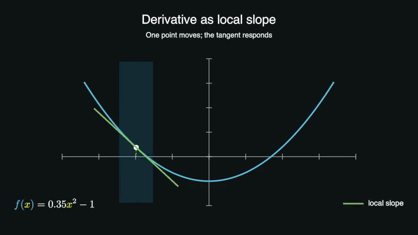

# 运行与开发

Python 3.11 及以上可运行编排内核和纯数据测试。动画制作使用 ManimGL；本机渲染环境由安装脚本单独准备。

## 先跑内核

```bash
python3 -m venv .venv
source .venv/bin/activate
python -m pip install -e ".[dev]"
MANIMIND_DISABLE_DOTENV=1 python -m pytest -q tests/test_workflow.py tests/test_task_board.py
```

这组测试检查任务分发、依赖图和审核角色。已有 `manimgl_env` 的成员可直接用其中的 Python 运行相同命令。

可以用保留的示例编译第一份项目计划：

```bash
MANIMIND_DISABLE_DOTENV=1 python -m manimind.main plan configs/pipeline.example.json --session-id getting-started
```

该命令生成计划和状态文件；渲染从下面的工程演示开始。

## macOS 动画环境

```bash
bash scripts/setup-manimgl.sh
source manimgl_env/bin/activate
MANIMIND_DISABLE_DOTENV=1 python -m manimind.main doctor
```

脚本创建 Python 3.12 环境，安装 ManimGL 并准备 FFmpeg 与 TeX；Node/Bun 已存在时链接到环境，缺少时按需安装。`doctor` 输出当前工具可用情况。

## 第一个动画

```bash
manimgl examples/manimgl_backend_smoke.py ManimGLBackendSmoke -w -l \
  --config_file configs/engineering-smoke.yml \
  --video_dir outputs/engineering-smoke/media --file_name engineering-smoke
```

这是一个 9.6 秒的工程演示：曲线上一点移动，切线随之变化。它验证渲染、文字和公式工具链；课程作品从[作品目录](../作品/README.md)查看。



## Windows 动画环境

```powershell
powershell -ExecutionPolicy Bypass -File .\scripts\setup-manimgl.ps1
.\manimgl_env\Scripts\Activate.ps1
python -m manimind.main doctor
```

FFmpeg、XeLaTeX、dvisvgm 及中文字体按 `doctor` 的结果配置。渲染器使用根目录 `manimgl.yml`；声音服务由维护者单独管理。

## 开发检查

```bash
MANIMIND_DISABLE_DOTENV=1 python -m pytest -q tests/test_repository_organization.py tests/test_legacy_cli_boundary.py
python scripts/check_repository_organization.py
```

完整测试按[测试分层](../ai/testing.md)分别运行：纯数据、媒体工具、原生绘图、本机素材和外部服务。成员提交修改时注明实际运行的层次和结果。

基础 CLI 的 `plan`、`context-pack`、`task-update` 用于计划和状态操作。课程制作命令集中在 [AI 导航](../ai/README.md)；历史流水线从[归档入口说明](../ai/legacy-cli.md)进入。

## 环境与安装记录

项目同时保留 `uv.lock` 和渲染依赖快照。现有安装脚本仍按版本范围解析依赖；重建环境时记录平台、Python、包版本及工具检查结果。安装包与 API 目前以源码工作区为运行单位。
