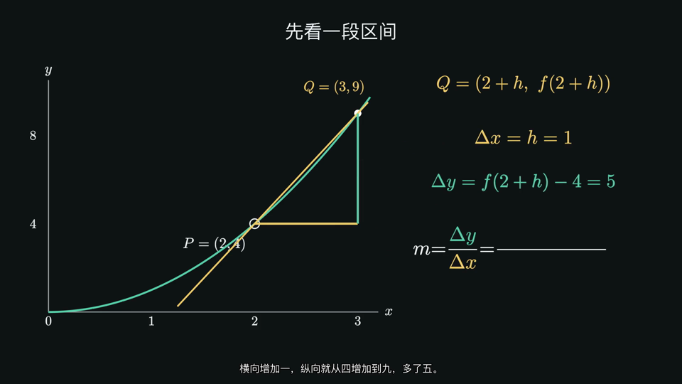

# 已有播放包

下表原有播放包位于本机 `~/Desktop/01-知识动画/01-当前成片/`，本轮分课修订预览位于 `02-展示与对比/导数动效修订-20261103/`。本页按真实交付登记，SHA 与原生来源记录在[机器可读目录](../目录.json)。

| 作品 | 本机目录 | 内容与版本 |
| --- | --- | --- |
| 导数及其应用 | `高中数学-导数整章-配音字幕版-20261103/` | 原配音字幕版，八课及整章合集，人工听审待安排 |
| 机械波小单元 | `机械波小单元-完整版-20261031/` | 传播与质点、空间图与时间图、脉冲叠加 |
| 三题知识动画 | `三题知识动画-配音字幕版-20261028/` | 电磁感应、导数与局部线性、特征向量 |
| 平抛运动 | `平抛运动-非线性配音字幕版-20261027/` | 非线性解释完整配音字幕版 |

## 导数分课名称

### 01 修订预览

新 01 为 228 秒的变量动效修订配音字幕预览，单套烧录字幕；原生来源为 `outputs/math-derivative-intro-20261101/captioned-v010/delivery.json`。独立字幕像素审核和完整解码已通过，人工听审与学生试用待安排。

本机位置：`~/Desktop/01-知识动画/02-展示与对比/导数动效修订-20261103/01-导数入门-从平均变化率到导数-变量动效修订版.mp4`。本次只登记主控已经创建的播放文件，原整章版继续保留。

### 07 修订预览

新 07 为 322.2 秒的配音字幕修订预览，单套烧录字幕，完整解码通过。原生来源为 `outputs/math-derivative-ch07-extremes-20261102/captioned-v007/delivery.json`。

本机位置：`~/Desktop/01-知识动画/02-展示与对比/导数动效修订-20261103/07-闭区间最值-先找候选再比较-变量动效修订版.mp4`，同目录有 `07-制作信息.json`。

01、07 的人工听审、自然度、发音及学生测试均未进行；原整章版保持原样，其他分课继续返修。

### 原整章版课目

1. 从平均变化率到导数
2. 从点导数到基本导函数
3. 求导的四则运算法则
4. 复合函数的变化怎样传递
5. 由导数读函数的增减
6. 驻点与局部极值
7. 指定区间里的最大与最小
8. 从裁纸做盒到最优体积

当前返修版的进度另见[草稿区](../草稿/README.md)。已有包在本轮整理中保持原字节与原名称。
